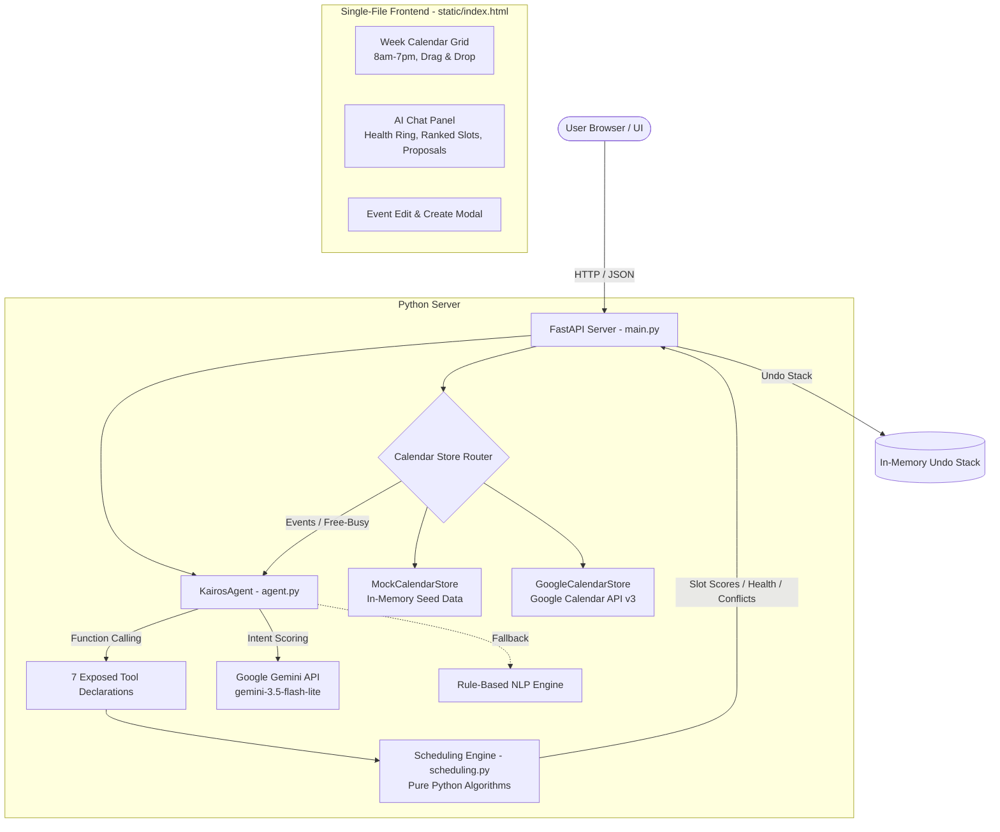

# Kairos – AI-Native Calendar for Business Users

> **"Propose, don't act."** A deterministic, agentic calendar assistant designed for busy professionals, executives, and managers that automates schedule optimization while keeping the human firmly in control.

Kairos reimagines calendar management by treating the calendar not as a passive viewer, but as an active, intelligent partner. Instead of forcing business users to manually negotiate meeting slots, resolve double-bookings, and scramble for deep-work focus time, Kairos parses natural-language intent (e.g., *"Find 45 mins with Priya and Rahul before Friday"* or *"Fix my Thursday"*), evaluates schedules using deterministic Python optimization algorithms, and presents transparent, ranked proposals with clear visual diffs and plain-English "why" rationales. Changes are never committed to the user's calendar until they click **✓ Approve**, with instant single-click **↩ Undo** support across all actions.

---

## ⚡ Features (What Works Today)

- **AI Intent Parsing with Tool Calling**: Gemini-powered LLM agent equipped with 7 function declarations to inspect schedules, evaluate free/busy intervals, detect conflicts, and propose rescheduling.
- **Cascading LLM Fallback Chain**: Automatically tries `gemini-3.5-flash-lite` $\rightarrow$ `gemini-4-hydrogen` $\rightarrow$ `gemini-3.8-flash` $\rightarrow$ offline rule-based fallback, ensuring high availability even during API deprecations or offline development.
- **Propose, Don't Act (Ghost Previews)**: Suggestions appear as dashed "ghost" blocks on the calendar grid accompanied by structured proposal cards showing before-and-after diffs.
- **Interactive Drag & Drop Rescheduling**: Directly drag any calendar block across time slots or days with visual drop indicators snapping to 15-minute intervals.
- **Direct Manual Event Management**: Create new blocks via the header button or by clicking any empty grid slot; rename meetings directly via the inline details modal; delete blocks via quick hover `✕` icons.
- **Deterministic Scheduling Engine**: Pure Python algorithm for slot scoring, back-to-back elimination, fragmentation detection, and strict focus block placement.
- **Calendar Health Score (0–100)**: Real-time animated health ring tracking meeting load, focus blocks, back-to-back meetings, and double-booking conflicts.
- **Dual Pluggable Backends**: Toggle seamlessly between an in-memory `MockCalendarStore` (pre-seeded with a realistic, chaotic demo week) and a live `GoogleCalendarStore` (OAuth2 Desktop flow).
- **Universal Single-Click Undo**: In-memory undo stack that cleanly reverts AI proposals, manual additions, drag-and-drop moves, renames, and deletions.

---

## 🛠 Tech Stack

- **Backend Framework**: [FastAPI](https://fastapi.tiangolo.com/) (Python 3.10+) – High-performance asynchronous API framework serving REST endpoints and static assets. *(See [ADR 1 in THOUGHT_PROCESS.md](file:///e:/CodeFiles/kairos/THOUGHT_PROCESS.md#adr-1-fastapi-for-backend-service))*
- **AI / LLM Engine**: [Google GenAI SDK](https://github.com/google-gemini/generative-ai-python) (`google-genai` & `google-generativeai`) – Multi-turn function calling with cascading model fallbacks. *(See [ADR 2 in THOUGHT_PROCESS.md](file:///e:/CodeFiles/kairos/THOUGHT_PROCESS.md#adr-2-llm-selection--cascading-fallback-chain))*
- **Deterministic Scheduling Logic**: Native Python `datetime` & `timedelta` – Hallucination-free interval arithmetic, conflict detection, and slot ranking. *(See [ADR 5 in THOUGHT_PROCESS.md](file:///e:/CodeFiles/kairos/THOUGHT_PROCESS.md#adr-5-deterministic-python-vs-llm-for-slot-calculation))*
- **External Integration**: [Google Calendar API v3](https://developers.google.com/calendar/api) via `google-api-python-client` – OAuth 2.0 Desktop client for live two-way calendar sync. *(See [ADR 3 in THOUGHT_PROCESS.md](file:///e:/CodeFiles/kairos/THOUGHT_PROCESS.md#adr-3-desktop-oauth-vs-service-account-for-google-calendar))*
- **Data Validation & Schemas**: [Pydantic v2](https://docs.pydantic.dev/) – Strict typing and data serialization across domain models.
- **Frontend Architecture**: Single-file Vanilla JavaScript (ES6+), HTML5 Drag and Drop API, and Tailwind CSS (CDN) – Zero build steps, instant reloads, and minimal footprint.
- **Testing Suite**: [pytest](https://pytest.org/) – Automated unit and integration testing covering interval subtraction, slot ranking, health calculations, and manual CRUD undo.

---

## 📐 Architecture Overview



### Component Breakdown
1. **Frontend (`static/index.html`)**: Interactive single-page interface providing a 5-day week calendar grid (8:00–19:00), HTML5 drag-and-drop rescheduling, inline event modals, an animated health score ring, and an AI chat assistant.
2. **FastAPI Layer (`main.py`)**: REST API gateway handling chat dispatches, proposal approval/rejection, manual event CRUD, live health score evaluations, and static file serving.
3. **Agent Loop (`agent.py`)**: Manages the conversational state machine with Gemini tool calling, argument extraction, per-turn proposal isolation, and cascading model fallbacks.
4. **Deterministic Scheduling (`scheduling.py`)**: Pure Python engine computing non-overlapping intervals, buffer management, strict focus window planning (morning 9–13 vs afternoon 14–18), and calendar health scoring.
5. **Calendar Store Abstraction (`calendar_store.py`)**: Abstract base class (`CalendarStore`) decoupling application logic from storage mechanisms (`MockCalendarStore` for zero-setup demos vs `GoogleCalendarStore` for real accounts).

---

## 🚀 Setup & Installation

### Prerequisites
- Python 3.10, 3.11, or 3.12 (WSL2 Linux environment recommended on Windows).
- A modern web browser (Chrome, Edge, Firefox, Safari).
- *(Optional)* A [Google Gemini API Key](https://aistudio.google.com/) for live AI intent parsing.
- *(Optional)* A Google Cloud Console project with Calendar API enabled for live Google Calendar sync.

### 1. Clone the Repository
```bash
git clone https://github.com/your-username/kairos.git
cd kairos
```

### 2. Set Up Virtual Environment & Dependencies
```bash
# Create and activate virtual environment
python3 -m venv venv
source venv/bin/activate    # On Windows PowerShell: .\venv\Scripts\Activate.ps1

# Install required dependencies
pip install -r requirements.txt
```

### 3. Configure Environment Variables
Copy `.env.example` to create your local `.env`:
```bash
cp .env.example .env
```

Edit `.env` with your preferred settings:
```ini
# Google Gemini API Key (optional - defaults to rule-based offline mode if unset)
GEMINI_API_KEY="your-gemini-api-key-here"

# Model selection (Kairos automatically falls back across models)
GEMINI_MODEL="gemini-3.5-flash-lite"

# Calendar Backend: 'mock' (in-memory demo) or 'google' (live Google Calendar)
CALENDAR_BACKEND="mock"

# Google Calendar ID (only needed if using Google backend; do NOT use primary for seeding)
GOOGLE_CALENDAR_ID="primary"

# Email notifications for created events (keep false for testing)
SEND_INVITES="false"
```

### 4. Run the Application
```bash
uvicorn main:app --host 0.0.0.0 --port 8000
```
Open **[http://localhost:8000](http://localhost:8000)** in your browser. The app runs immediately with mock demo data even without an API key!

---

## 🔑 Google Calendar OAuth Setup (Optional)

To connect Kairos to a real Google Calendar account:

1. **Enable the API**: Go to the [Google Cloud Console](https://console.cloud.google.com/) $\rightarrow$ APIs & Services $\rightarrow$ Library $\rightarrow$ Enable **Google Calendar API**.
2. **Configure Consent Screen**: APIs & Services $\rightarrow$ OAuth consent screen $\rightarrow$ Choose **External** $\rightarrow$ Under **Test users**, add your personal Gmail address.
3. **Create Credentials**: APIs & Services $\rightarrow$ Credentials $\rightarrow$ Create Credentials $\rightarrow$ **OAuth Client ID** $\rightarrow$ Application type: **Desktop app**.
4. **Save Credentials**: Download the JSON credentials file, rename it to **`credentials.json`**, and place it directly in the project root directory.
5. **Connect**: Click **Connect Google Calendar** in the Kairos header or visit `http://localhost:8000/auth/google`. Complete the standard Google OAuth consent flow. Tokens will be cached in `token.json`.
6. *(Optional)* **Seed Test Calendar**: To avoid cluttering your personal calendar, create a secondary calendar in Google Calendar (e.g., "Kairos Test"), copy its Calendar ID from settings into `GOOGLE_CALENDAR_ID` in `.env`, and run:
   ```bash
   python seed_google.py
   ```

---

## 💡 Usage & Key Workflows

### Flow 1: Calendar Health Audit
- Click the suggestion chip: **"How's my week looking?"**
- Gemini calls `get_calendar_health`, checks meeting density, back-to-back fatigue, and conflicts, displaying an updated health score and plain-English summary.

### Flow 2: Multi-Attendee Meeting Scheduling
- Prompt: **`Find 45 mins with Priya and Rahul before Friday`**
- Gemini calls `find_meeting_slots`, checks attendee busy times from the store, ranks top-3 open slots avoiding lunch and conflicts, and displays ranked cards with an inline editable meeting title.
- Click any slot card $\rightarrow$ Review the ghost block on the grid $\rightarrow$ Click **✓ Approve**.

### Flow 3: Strict Morning Focus Time Protection
- Prompt: **`Block 2 hours of focus time every morning this week`**
- The scheduling engine strictly evaluates morning hours (`09:00–13:00`) around existing standups. If space allows, it proposes deep-work blocks; if mornings are full, it honestly explains why without spilling into afternoon hours.

### Flow 4: Interactive Drag & Drop & Direct Editing
- **Reschedule**: Grab any event card (e.g., *1:1 with Priya*) and drag it to another day or time. Release to drop at the 15-minute snapped interval.
- **Rename**: Click any event block $\rightarrow$ Edit the title in the modal input field $\rightarrow$ Press Enter or click **💾 Save**.
- **Delete**: Hover over any event and click the red **`✕`** icon.
- **Undo**: Click **`↩ Undo`** in the top navigation bar to immediately revert any change.

---

## 📂 Project Structure

```text
kairos/
├── main.py                 # FastAPI application routes, manual event endpoints & app lifecycle
├── agent.py                # KairosAgent: Gemini function calling loop, tool dispatch & fallback rules
├── calendar_store.py       # CalendarStore interface, MockCalendarStore & GoogleCalendarStore
├── scheduling.py           # Pure Python scheduling engine: find_slots, health_score, conflicts
├── models.py               # Pydantic domain models: Event, Proposal, Change, SlotOption, HealthReport
├── seed_data.py            # Deterministic mock calendar week relative to current Monday
├── seed_google.py          # Idempotent Google Calendar seeder (refuses to run on primary)
├── static/
│   └── index.html          # Single-file UI: Calendar grid, drag & drop, Tailwind styling, AI panel
├── tests/
│   ├── test_scheduling.py  # Unit tests for slot searching, conflict detection & health scoring
│   └── test_manual_crud.py # Integration tests for manual create, move, rename, delete & undo
├── requirements.txt        # Python dependency manifest
├── .env.example            # Sample environment variables template
├── TODO                    # Active backlog and completed features
├── THOUGHT_PROCESS.md      # In-depth architectural design document, retrospective & ADRs
└── README.md               # Project overview, setup instructions & quickstart guide
```

---

## 🧪 Testing

The test suite validates core scheduling logic, timezone boundary safety, back-to-back meeting detection, and the multi-action undo stack.

Run tests using `pytest`:
```bash
pytest tests/ -v
```

### Test Coverage Highlights
- `tests/test_scheduling.py`:
  - `test_returns_slots_when_calendar_has_gaps`: Verifies slot generation in free calendar windows.
  - `test_respects_working_hours`: Confirms events are never placed before 9:00 AM or after 6:00 PM.
  - `test_skips_lunch_hour`: Verifies the 13:00–14:00 lunch break is strictly respected.
  - `test_detects_double_booking`: Validates conflict detection for overlapping meetings.
  - `test_detects_back_to_back`: Verifies meetings with `< 10m` gaps increment the back-to-back penalty.
  - `test_plan_focus_blocks_morning_only`: Ensures morning requests never schedule into the afternoon.
- `tests/test_manual_crud.py`:
  - `test_manual_create_event_and_undo`: Verifies manual block creation and immediate restoration.
  - `test_manual_update_move_event_and_undo`: Tests drag-and-drop coordinate updates and undo reversion.
  - `test_manual_delete_event_and_undo`: Tests direct block deletion and restore.
  - `test_manual_rename_event_and_undo`: Verifies inline title editing and undo.

---

## ⚠️ Known Limitations

1. **Single-User Scope**: Current version is optimized for an individual calendar owner. Multi-user synchronized team calendars and delegate/EA modes are scheduled for future iterations.
2. **In-Memory Volatility**: The mock store and undo history reside in server memory and reset upon server restart. *(See proposed [PostgreSQL Schema in THOUGHT_PROCESS.md](file:///e:/CodeFiles/kairos/THOUGHT_PROCESS.md#proposed-postgresql-schema) for persistent storage).*
3. **Hardcoded Work Windows**: Standard working hours (09:00–18:00) and lunch (13:00–14:00) are currently fixed defaults. A dedicated user preferences profile modal is in the roadmap.
4. **Google Workspace Free/Busy Boundaries**: External attendee availability is limited by Google's security sandbox; attendees outside your organization or without shared access are marked as "availability unknown".

For complete architectural trade-offs, engineering retrospectives, and debugging evidence, read the [THOUGHT_PROCESS.md](file:///e:/CodeFiles/kairos/THOUGHT_PROCESS.md).

---

## 📚 Documentation Links

- **[Architectural Design Document & Retrospective (THOUGHT_PROCESS.md)](file:///e:/CodeFiles/kairos/THOUGHT_PROCESS.md)**: Detailed problem breakdown, architecture decision records (ADRs), post-mortem debugging logs, and AI disclosure.
- **[Active Backlog (TODO)](file:///e:/CodeFiles/kairos/TODO)**: Completed milestones and planned features.
